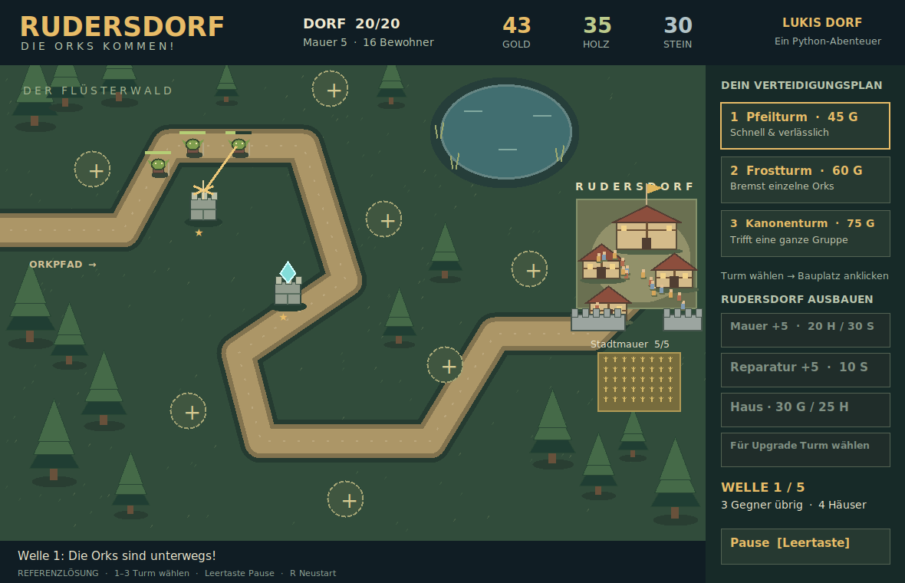

# Rudersdorf · Die Orks kommen!

**Lukis Python-Werkstatt:** Verteidige ein kleines mittelalterliches Dorf gegen Orks,
Wolfsreiter und Oger. Baue Türme, schütze deine Nachbarn und lass Rudersdorf wachsen.
Du programmierst die Spielregeln — die grafische Welt ist schon vorbereitet.



## Los geht's

Du brauchst **Python 3.10 oder neuer mit Tkinter**. Keine zusätzlichen Python-Pakete,
kein Konto und keine Internetverbindung zum Spielen oder Testen.
Das Fenster ist 1180 × 760 Pixel groß; plane zusätzlich Platz für die Fensterleiste ein.

1. Lade dieses Repository über **Code → Download ZIP** herunter und entpacke es,
   oder klone es mit `git clone https://github.com/konih/rudersdorf.git`.
2. Öffne den Ordner `rudersdorf` im Editor und ein Terminal **in diesem Ordner**.
3. Prüfe Python und Tkinter: `python -m tkinter`. Ein kleines Testfenster sollte erscheinen.
4. Starte deine Werkstatt:

   ```sh
   python spielen.py
   ```

5. Öffne [AUFGABEN.md](AUFGABEN.md) und löse Aufgabe 1 in **[modell.py](modell.py)**.
6. Teste nur diese Aufgabe:

   ```sh
   python pruefen.py 1
   ```

> Je nach Installation heißt der Befehl `python3` oder unter Windows `py`.
> Ersetze dann `python` in **allen** Befehlen entsprechend.
> Wenn mehrere Python-Versionen installiert sind, verwende für Spiel und Tests dieselbe.

**Wichtig:** Die Werkstatt ist absichtlich ungelöst. Du siehst das Dorf sofort,
aber Aktionen können auf eine noch offene Aufgabe hinweisen. Erst nach den
Grundaufgaben 1–6 läuft eine vollständige Partie. Die Referenz wird niemals
unbemerkt geladen und deine Aufgaben werden niemals automatisch übersprungen.

### Tkinter fehlt?

- **Windows:** Installiere Python von [python.org](https://www.python.org/downloads/).
  Die Installationskomponente „Tcl/Tk and IDLE“ muss enthalten sein.
- **macOS:** Die Python-Installation von [python.org](https://www.python.org/downloads/macos/)
  bringt Tkinter mit. Prüfe anschließend `python3 -m tkinter`.
- **Ubuntu/Debian:** `sudo apt install python3-tk`, anschließend
  `/usr/bin/python3 -m tkinter`. Verwende dann auch für das Spiel `/usr/bin/python3`.
  Ein separat installiertes Python (etwa Homebrew) verwendet dieses Tkinter nicht automatisch.
- **Kein Bildschirm / Online-Editor:** Die Unit-Tests brauchen kein Fenster.
  Das Spiel braucht einen grafischen Desktop; ein Terminal allein reicht nicht.

## Spielen

- **1 / 2 / 3:** Pfeil-, Frost- oder Kanonenturm auswählen.
- **Klick auf einen runden Bauplatz:** Turm kaufen und bauen. Der Preis wird oben rechts angezeigt.
- **N oder „Nächste Welle“:** Den nächsten Angriff starten. Wellen starten nie von selbst.
- **Leertaste:** Angriff pausieren/fortsetzen; zwischen Wellen die nächste starten.
- **Klick auf einen gebauten Turm:** Reichweite sehen und ihn für ein Upgrade auswählen.
- **Dorf-Schaltflächen:** Zwischen Wellen Mauer bauen, reparieren oder Häuser ergänzen.
  Diese Aktionen gehören zu den Zusatzaufgaben 7–9.
- **R:** Neue Partie beginnen, auch nach Sieg oder Niederlage. Verwirft den aktuellen Spielstand.
- **Esc:** Einen Aufgabenhinweis schließen. Nach Codeänderungen das Fenster schließen und neu starten.

**Ziel:** Überstehe alle fünf Wellen mit mindestens einem Dorf-Lebenspunkt.
Ein durchgebrochener Ork oder Wolfsreiter verursacht 1 Schaden, ein Oger 3.
Eine vorhandene Stadtmauer fängt Schaden zuerst ab.
Besiegte Gegner geben Gold. Zwischen Wellen erhältst du Grundversorgung:
35 Gold, 15 Holz und 10 Stein. Mit Zusatzaufgabe 8 kommt das Einkommen des Dorfes hinzu.
Nach der letzten Welle ist das Spiel gewonnen; danach gibt es kein weiteres Einkommen.

## Dein Lernpfad

| Mission | Schwerpunkt | Testbefehl |
| --- | --- | --- |
| 1 · Die Orks bekommen Namen | Klassen, `__init__`, `self` | `python pruefen.py 1` |
| 2 · Treffer! | Methoden, Bedingungen, Grenzfälle | `python pruefen.py 2` |
| 3 · Die Dorfkasse | Dictionaries, faire Bezahlung | `python pruefen.py 3` |
| 4 · Wen beschießen wir? | Listen, Schleifen, Zielauswahl | `python pruefen.py 4` |
| 5 · Eis und Donner | Vererbung, `super()`, Überschreiben | `python pruefen.py 5` |
| 6 · Nach dem Kampf | Neue Listen, Belohnungen | `python pruefen.py 6` |
| 7 · Die Stadtmauer | Zusatz: Ausbau, Reparatur, Grenzen | `python pruefen.py 7` |
| 8 · Neue Nachbarn | Zusatz: Häuser und Einkommen | `python pruefen.py 8` |
| 9 · Die Turmschmiede | Zusatz: Upgrades und Vererbung | `python pruefen.py 9` |

`python pruefen.py --basis` prüft 1–6, `python pruefen.py --alle` prüft 1–9.
Ohne Argument beginnt der Teststarter bei Aufgabe 1. Fehlende Aufgaben und falsche
Ergebnisse führen bewusst zu Exitcode 1; alles richtig ergibt Exitcode 0.
Die Tests nennen Erwartung, tatsächliches Ergebnis und einen Hinweis.
Ein echter Python-Fehler zeigt zusätzlich die Fehlerstelle.

## Referenzlösung — erst selbst tüfteln!

Die vollständige Lösung liegt getrennt in **[loesung/](loesung/)**.
Sie verwendet dieselbe Oberfläche und dieselben Tests:

```sh
python spielen.py --loesung
python pruefen.py --alle --loesung
```

Deine `modell.py` wird dadurch weder verändert noch ersetzt. Auch ein versehentlich
gesetzter Umgebungswert schaltet `pruefen.py` nicht auf die Referenz um: Nur
`--loesung` tut das. Zum Vergleichen öffne beide Dateien nebeneinander, möglichst
erst nach einem eigenen Versuch.

## Wo finde ich was?

| Datei | Zweck |
| --- | --- |
| `modell.py` | **Deine Baustelle:** Grundaufgaben und Zusätze, ohne Lösungen |
| `AUFGABEN.md` | Ausführliche Missionen mit Verträgen, Beispielen und gestuften Hinweisen |
| `KNOBELAUFGABEN.md` | Freie Erweiterungen mit Ideen für eigene Tests |
| `welt.py` | Karte, Bauplätze, Baupläne, Gegnerdaten und Wellen |
| `spielkern.py` | Vorbereitete Spielschleife, ohne Tkinter testbar |
| `oberflaeche.py` | Vorbereitete Zeichnungen, Animationen und Bedienung |
| `pruefen.py`, `tests/` | Lernfeedback und Techniktests |
| `loesung/modell.py` | Vollständig gelöste Aufgaben 1–9 |
| `FUER-ELTERN.md` | Lernbegleitung und technische Prüfung |
| `ERWEITERN.md` | Wegweiser für weitere Gebäude, Berufe und Spielideen |

Alle Grafiken werden mit Tkinter gezeichnet. Keine externen Bilddateien nötig.
Die Karte ist bewusst kompakt, der Schwierigkeitsgrad ein Einstieg, kein fertiges
kommerzielles Strategiespiel. Es gibt noch keine Speicherstände oder Sounds.
Auf der Karte werden maximal acht Häuser und zwanzig Bewohner gezeichnet;
die Zähler und die Wirtschaft wachsen darüber hinaus weiter.

Lizenz: [MIT](LICENSE).
